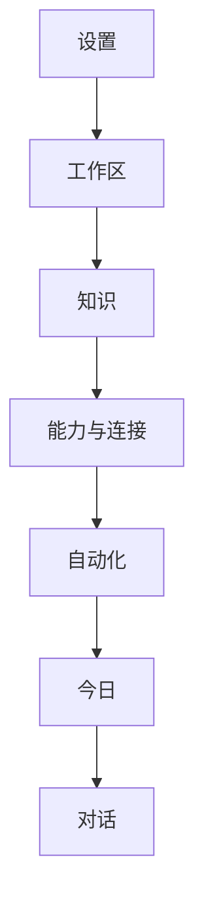
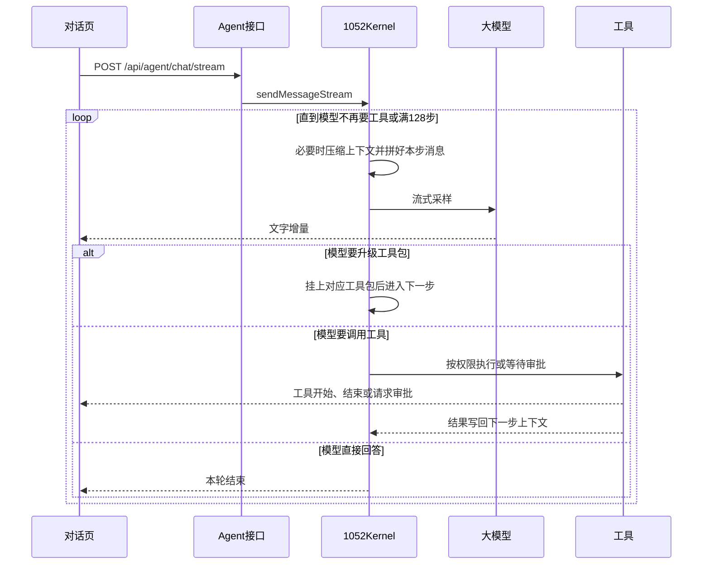

# 前后端模块梳理方案

按侧栏菜单一项一项看。每一项只回答三件事：页面做什么、调用 [frontend/src/data/api.ts](frontend/src/data/api.ts) 里的哪组接口、后端哪个模块读写 `data/`。不按文件逐个拆。

侧栏从上到下是「今日 → 对话 → 工作区 → 知识 → 自动化 → 能力与连接 → 设置」。对话和今日都会用到下面那些菜单的数据，所以梳理顺序倒过来：先看独立菜单，最后看对话。

菜单定义在 [frontend/src/app/navigation.tsx](frontend/src/app/navigation.tsx)。

## 1. 设置

页面都在 [frontend/src/pages/SettingsPage.tsx](frontend/src/pages/SettingsPage.tsx)。

1. **模型接入** `/settings/models`。看 profile、当前激活模型、`apiFormat`、API Key、本地模型发现，以及图像生成和 OCR 用哪套模型。后端是 [backend/src/modules/settings](backend/src/modules/settings)，数据在 `data/settings.json`。对话选模型只看这里的 `resolveLlmConfigForTask(..., 'agent-chat')`：任务绑定的已启用 profile，否则当前激活 profile，否则第一个已启用 profile。
2. **Agent 与权限** `/settings/agent`。看权限档、是否流式、用户长期偏好、渐进式工具披露、缓存、checkpoint、自动压缩、早报。这些开关决定对话内核怎么跑，对话页本身不改它们。
3. **外观与动态** `/settings/appearance`。主题档案。后端 [backend/src/modules/appearance](backend/src/modules/appearance)。和对话无关，确认保存和套用即可。
4. **系统维护** `/settings/system`。健康检查、更新、数据迁移。后端 [backend/src/modules/updates](backend/src/modules/updates)。

## 2. 工作区

页面 [frontend/src/pages/WorkspacePage.tsx](frontend/src/pages/WorkspacePage.tsx)，视图在 [frontend/src/features/workspace/WorkspaceViews.tsx](frontend/src/features/workspace/WorkspaceViews.tsx)。

1. **本地仓库** `/workspace/repositories`。登记仓库、看目录、读文件。后端 [backend/src/modules/repository](backend/src/modules/repository)。
2. **SQL 工作台** `/workspace/sql`。选数据源和 SQL，执行查询，结果进表格。
3. **数据源** `/workspace/datasources`。SQLite、MySQL，以及经 Python 的 Oracle / Hive。创建、测试、删除。
4. **SQL 文件** `/workspace/sql-files`。保存的 SQL 文本。
5. **变量** `/workspace/variables`。查询变量。
6. **远程服务器** `/workspace/servers`。SSH 服务器，测试连接。
7. **Shell 文件** `/workspace/shell-files`。保存并执行 shell。执行落到 [backend/src/modules/terminal](backend/src/modules/terminal)。

2 到 7 的后端都在 [backend/src/modules/sql](backend/src/modules/sql)。对话里的 SQL、仓库、终端工具就是调这些模块，页面先看清人工怎么用。

## 3. 知识

页面 [frontend/src/pages/KnowledgePage.tsx](frontend/src/pages/KnowledgePage.tsx)。笔记、Wiki、记忆、资源、检索、输出配置在 [frontend/src/features/knowledge/KnowledgeViews.tsx](frontend/src/features/knowledge/KnowledgeViews.tsx)，深度研究在 [frontend/src/features/knowledge/ResearchView.tsx](frontend/src/features/knowledge/ResearchView.tsx)。

1. **笔记** `/knowledge/notes`。本地 Markdown 目录。未配置目录时页面提示「尚未配置笔记目录」。后端 [backend/src/modules/notes](backend/src/modules/notes)。
2. **Wiki** `/knowledge/wiki`。结构化知识页，含 lint 和重建。后端 [backend/src/modules/wiki](backend/src/modules/wiki)。
3. **记忆** `/knowledge/memory`。长期记忆、建议确认或拒绝、敏感记忆只展示目录。后端 [backend/src/modules/memory](backend/src/modules/memory)。对话只在挂上 memory-pack 时把相关记忆写进提示词。
4. **资源** `/knowledge/resources`。片段库。后端 [backend/src/modules/resources](backend/src/modules/resources)。
5. **知识检索** `/knowledge/search`。对笔记、Wiki、记忆、资源、技能、日程做索引和搜索。后端 [backend/src/modules/pkm](backend/src/modules/pkm)。索引建议会单独调一次模型，不走对话内核。
6. **深度研究** `/knowledge/research`。按步骤搜索、摘录、审核、主张、证据、写回 Wiki。每步是普通 POST，不是流式对话。后端在 [backend/src/modules/websearch](backend/src/modules/websearch)，会话库是 `data/research/research-sessions.sqlite`。
7. **输出配置** `/knowledge/output-profiles`。规定某种场景下 Agent 怎么说话。后端 [backend/src/modules/output-profiles](backend/src/modules/output-profiles)。对话每一轮都会把当前配置拼进系统提示词。

## 4. 能力与连接

页面 [frontend/src/pages/CapabilitiesPage.tsx](frontend/src/pages/CapabilitiesPage.tsx)，视图在 [frontend/src/features/capabilities/CapabilityViews.tsx](frontend/src/features/capabilities/CapabilityViews.tsx)。

1. **Skills** `/capabilities/skills`。安装、查看、删除技能包。后端 [backend/src/modules/skills](backend/src/modules/skills)。对话把已启用技能目录放进提示词，需要时再读具体 `SKILL.md`。
2. **工具箱** `/capabilities/tools`。UAPIs 目录，启用和试调用。后端 [backend/src/modules/uapis](backend/src/modules/uapis)。
3. **搜索源** `/capabilities/search`。开关搜索引擎。后端仍是 websearch 模块。
4. **外部通道** `/capabilities/channels`。微信登录、飞书连接、企业微信 webhook。页面只做连接配置。入站消息不在这里回复，它们进入同一份对话历史。后端在 [backend/src/modules/channels](backend/src/modules/channels)。企业微信只出站，不进 Agent。

## 5. 自动化

页面 [frontend/src/pages/AutomationsPage.tsx](frontend/src/pages/AutomationsPage.tsx)。日历、定时任务、执行记录在 [frontend/src/features/automations/AutomationViews.tsx](frontend/src/features/automations/AutomationViews.tsx)，流程编排在 [frontend/src/features/automations/AutomationFlowView.tsx](frontend/src/features/automations/AutomationFlowView.tsx)。

1. **日历** `/automations/calendar`。事件的增删改查。后端 [backend/src/modules/calendar/calendar.service.ts](backend/src/modules/calendar/calendar.service.ts)。
2. **定时任务** `/automations/tasks`。目标是 Agent 或终端，可运行、暂停、恢复。Agent 目标会调用对话内核，但审批模式是拒绝，需要人工确认的工具直接失败。后端 [backend/src/modules/calendar/calendar.schedule.service.ts](backend/src/modules/calendar/calendar.schedule.service.ts)。
3. **流程编排** `/automations/orchestrations`。SQL、Shell、等待、调试、循环节点。后端 [backend/src/modules/orchestration](backend/src/modules/orchestration)。不经过大模型。
4. **执行记录** `/automations/runs`。定时任务运行记录和编排日志。

## 6. 今日

页面 [frontend/src/pages/TodayPage.tsx](frontend/src/pages/TodayPage.tsx)。它不拥有数据，只是把前面菜单的结果拼在一页。

1. **今日概览** `/today`。日程、启用中的定时任务、通知、记忆摘要、运行状态。输入框跳到 `/chat` 并把草稿带过去。
2. **通知中心** `/today/activity`。列表、标已读。后端 [backend/src/modules/notifications](backend/src/modules/notifications)。

## 7. 对话

菜单只有一项：**Agent 对话** `/chat`，页面 [frontend/src/pages/ChatPage.tsx](frontend/src/pages/ChatPage.tsx)。大模型回路在后端 [backend/src/modules/agent](backend/src/modules/agent)，对外只有 `sendMessageStream`，它直接跑 1052 Kernel。网页、微信、飞书、定时任务共用这一条回路。

### 页面上发生的事

1. 回车或发送：本地先放一条用户消息和一条空的助手消息。
2. 只把 `{ role, content }` 发给 `POST /api/agent/chat/stream`。空消息、还在输出的消息、错误消息不发。
3. [frontend/src/runtime/runtime.ts](frontend/src/runtime/runtime.ts) 读 SSE。文字增量贴到气泡上，工具、审批、压缩、报错进运行轨迹。浏览器不执行工具。
4. 正常结束后 `PUT /api/agent/history` 保存。点停止则中断请求。
5. 另一个页签或微信、飞书写入历史时，页面靠 `GET /api/agent/history/events` 刷新。自己正在输出时不刷新。

模型名字和权限档从设置里读，对话页不能改模型。

### 一次请求在后端怎么走

本步发给模型的内容，按这个顺序拼：

1. 系统提示词，文件是 [backend/prompts/agent-system.md](backend/prompts/agent-system.md)。
2. 当前权限、工作区、输出配置、技能目录；记忆只在 memory 工具包已挂载时加入。
3. 设置里的用户长期偏好。
4. 这次请求带上的历史。网页这条历史来自浏览器提交的正文，不是内核自己去读 `chat-history.json`。

模型从哪来：设置里 `agent-chat` 这条任务路由。接口格式按设置里的 `apiFormat`；没写就按地址和模型名判断 Anthropic、Gemini，或其他 OpenAI 兼容接口。流式输出空闲超过 5 分钟算失败。还没吐出字时，429 和 5xx 会再试两次。

工具从哪来：设置打开渐进披露时，先只有基础读取，模型调用升级后才出现仓库、搜索、记忆、技能、数据、通道等包。关闭时一次给出全部工具。读操作按权限直接执行。写操作在网页上会停住等用户允许或拒绝；定时任务和外部通道不等待，直接失败。工具结果再喂回模型，进入下一步。

网页这条链路结束时，内核写运行记录和 checkpoint，不写 `chat-history.json`。保存由对话页完成。

### 和另外两条入口的差别

| 谁发起 | 历史谁保存 | 需要确认的工具 |
| --- | --- | --- |
| 对话页 | 页面保存到 `data/chat-history.json` | 停住等用户点允许或拒绝 |
| 微信、飞书 | 通道写入同一份历史，再把回复发回通道 | 不等待，直接失败 |
| 定时任务 | 调度器写入，来源标记为定时任务 | 不等待，直接失败 |

三条入口之后的拼提示词、选模型、循环调工具，是同一套内核。
