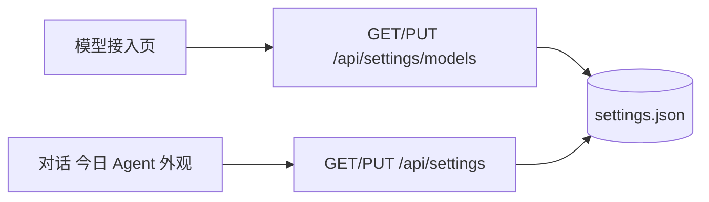

# 拆分模型设置接口

三个阶段都已实施。下面保留原来的步骤，作为当时的做法记录。

## 完成情况

计划里的 9 项都已完成。没有未做的步骤。

和原稿有一处有意不同：步骤 11 原本要求空 API Key 不覆盖已保存密钥。后来改为用户写什么就存什么，空字符串会清空密钥。`updateModelSettings` 沿用这个行为，测试断言的是清空，不是保留旧值。

仍按原稿保留、不算未完成：

- `effects.water` 的类型和归一化还在，没有页面入口。
- 磁盘上的 `appearance/theme-profiles.json` 没有删除。
- `frontend/src/styles/base.css` 的 `prefers-reduced-motion` 还在，跟随操作系统。
- `GET/PUT /api/settings`、档案激活和任务路由仍返回整份设置。

原稿里的「现状」段落写于实施之前，和现在的代码不一致。以本段为准。

## 阶段一：删除无用功能

### 步骤 1. 去掉减少动态

1. 在 [backend/src/modules/settings/settings.types.ts](backend/src/modules/settings/settings.types.ts) 删除 `AppearanceSettings.reduceMotion`。`effects.water` 没有页面，这次保留类型和归一化逻辑。
2. 在 [backend/src/modules/settings/settings.service.ts](backend/src/modules/settings/settings.service.ts) 删除 `normalizeReduceMotion`，以及 `normalizeAppearanceSettings` 里对 `reduceMotion` 的读写。
3. 在 [backend/src/modules/settings/settings.service.test.ts](backend/src/modules/settings/settings.service.test.ts) 删除 `reduceMotion` 的三条用例。水波 `effects.water` 的用例保留。
4. 在 [frontend/src/contracts/schemas.ts](frontend/src/contracts/schemas.ts) 的 `appearance` 对象里删除 `reduceMotion`。
5. 系统样式 [frontend/src/styles/base.css](frontend/src/styles/base.css) 里的 `@media (prefers-reduced-motion: reduce)` 保留，它跟随操作系统，不读这个开关。

### 步骤 2. 删除兼容主题包

1. 删除目录 [backend/src/modules/appearance](backend/src/modules/appearance)：`appearance.service.ts`、`appearance.routes.ts`、`appearance.types.ts`、`theme-compatibility.service.ts` 和 `__tests__/appearance.service.test.ts`。
2. 在 [backend/src/app.ts](backend/src/app.ts) 去掉 `appearanceRouter` 的 import 和 `app.use('/api/appearance', appearanceRouter)`。
3. 在 [backend/src/index.ts](backend/src/index.ts) 去掉 `seedBuiltinAppearanceProfiles` 的 import 和启动调用。
4. 在 [frontend/src/data/api.ts](frontend/src/data/api.ts) 删除 `appearanceApi`，以及它用到的主题 schema import。
5. 在 [frontend/src/contracts/schemas.ts](frontend/src/contracts/schemas.ts) 删除 `appearanceReviewIssueSchema`、`appearanceReviewReportSchema`、`appearanceThemeSpecSchema`、`appearanceThemeProfileSchema`、`publicAppearanceThemesSchema`，以及 `AppearanceThemeProfile`、`AppearanceReviewReport` 两个导出类型。
6. 在 [frontend/src/contracts/schemas.test.ts](frontend/src/contracts/schemas.test.ts) 删除主题包解析测试和对应 import。
7. 在 [frontend/src/pages/settings.module.css](frontend/src/pages/settings.module.css) 删除 `.themeRegistry` 及其响应式规则。主题卡片用的 `.themeGrid`、`.darkPreview`、`.lightPreview` 保留。
8. 不删除磁盘上的 `appearance/theme-profiles.json`。

### 步骤 3. 删除系统更新

1. 删除目录 [backend/src/modules/updates](backend/src/modules/updates)。
2. 在 [backend/src/app.ts](backend/src/app.ts) 去掉 `updatesRouter` 和 `app.use('/api/updates', updatesRouter)`。
3. 在 [backend/src/index.ts](backend/src/index.ts) 去掉 `initUpdaterState` 的 import 和 `await initUpdaterState()`。
4. 在 [frontend/src/data/api.ts](frontend/src/data/api.ts) 删除 `updatesApi` 和 `updateStatusSchema` import。
5. 在 [frontend/src/contracts/schemas.ts](frontend/src/contracts/schemas.ts) 删除 `updateStatusSchema`。

### 步骤 4. 删除历史数据迁移

1. 删除 [backend/src/modules/agent/agent.migration.service.ts](backend/src/modules/agent/agent.migration.service.ts)。
2. 在 [backend/src/modules/agent/agent.routes.ts](backend/src/modules/agent/agent.routes.ts) 去掉 migration import，以及 `POST /migrations/preview` 和 `POST /migrations/run`。
3. 在 [frontend/src/data/api.ts](frontend/src/data/api.ts) 的 `agentApi` 里删除 `previewMigration` 和 `runMigration`。
4. 在 [frontend/src/pages/settings.module.css](frontend/src/pages/settings.module.css) 删除 `.migrationForm` 和它的窄屏规则。`.updateStatus` 留给健康检查，不删。

## 阶段二：合并成通用设置

删完后，外观页只剩明暗主题，系统页只剩健康检查。合成一个页面。

### 步骤 5. 新建通用设置页

新建 [frontend/src/pages/setting/general.tsx](frontend/src/pages/setting/general.tsx)，从上到下两块：

- 「主题模式」：从现有外观页搬来曜石深色、钛白浅色。点击调用 `useShellStore` 的 `setTheme`，不请求设置接口。
- 「本地服务健康」：从现有系统页搬来健康查询、在线标记、最后响应时间和刷新按钮。继续用 `healthApi.status`，30 秒刷新一次。

这个页面不再调用 `settingsApi`，也不再放「保存外观设置」按钮。

### 步骤 6. 改导航和路由

1. 在 [frontend/src/app/navigation.tsx](frontend/src/app/navigation.tsx) 的设置分组里，用一条替换原来的两条：`{ label: '通用设置', path: '/settings/general', icon: Settings }`。`Settings` 图标已经在这个文件里。
2. 在 [frontend/src/app/App.tsx](frontend/src/app/App.tsx) 把 `AppearanceSettings`、`SystemSettings` 换成 `GeneralSettings`。路由改为 `path="general"`。
3. 增加两条重定向：`appearance` 和 `system` 都 `Navigate` 到 `/settings/general`，避免旧地址变成 404。
4. 删除 [frontend/src/pages/setting/appearance.tsx](frontend/src/pages/setting/appearance.tsx) 和 [frontend/src/pages/setting/system.tsx](frontend/src/pages/setting/system.tsx)。[frontend/src/pages/setting/index.tsx](frontend/src/pages/setting/index.tsx) 从导航生成侧栏，不用改。

### 步骤 7. 核对第一、二阶段

- 设置侧栏只剩「模型接入」「Agent 与权限」「通用设置」。
- 通用设置页能切换明暗，健康检查能显示在线并刷新。
- `/settings/appearance` 和 `/settings/system` 会跳到 `/settings/general`。
- 后端启动不再调用主题包种子和更新器初始化。

## 阶段三：拆分模型设置接口

## 现状

「减少动态」和「兼容主题包」都只写存储，不改变正在显示的界面。明暗切换保留：点「曜石深色 / 钛白浅色」会立刻写入 shell 状态，并由 [frontend/src/components/shell/AppShell.tsx](frontend/src/components/shell/AppShell.tsx) 设到 `documentElement.dataset.theme`。系统级 `prefers-reduced-motion` 样式也保留。

减少动态：

- 去掉 [frontend/src/pages/setting/appearance.tsx](frontend/src/pages/setting/appearance.tsx) 的「动态与可访问性」卡片，以及只为它存在的「保存外观设置」按钮和 `settingsApi` 请求。主题已经保存在本地 shell 状态里，设置接口里的 `appearance.theme` 没有被启动流程读回。
- 从 [backend/src/modules/settings/settings.types.ts](backend/src/modules/settings/settings.types.ts)、[backend/src/modules/settings/settings.service.ts](backend/src/modules/settings/settings.service.ts) 和 [frontend/src/contracts/schemas.ts](frontend/src/contracts/schemas.ts) 去掉 `reduceMotion`。
- 删除 [backend/src/modules/settings/settings.service.test.ts](backend/src/modules/settings/settings.service.test.ts) 里针对 `reduceMotion` 的用例。`effects.water` 没有页面入口，这次不动。

兼容主题包：

- 删除整个后端模块 [backend/src/modules/appearance](backend/src/modules/appearance)，包括主题包服务、兼容性检查、路由和测试。
- 从 [backend/src/app.ts](backend/src/app.ts) 卸下 `/api/appearance`。
- 删除 [frontend/src/data/api.ts](frontend/src/data/api.ts) 的 `appearanceApi`，以及 [frontend/src/contracts/schemas.ts](frontend/src/contracts/schemas.ts) 和 [frontend/src/contracts/schemas.test.ts](frontend/src/contracts/schemas.test.ts) 中的主题包 schema。
- 去掉外观页的主题包编辑器，以及 [frontend/src/pages/settings.module.css](frontend/src/pages/settings.module.css) 里只给它用的 `.themeRegistry` 样式。
- 磁盘上的 `appearance/theme-profiles.json` 不再被读取，不主动删除用户数据文件。
- [backend/src/index.ts](backend/src/index.ts) 里的 `seedBuiltinAppearanceProfiles()` 随主题包模块一起去掉。

## 删除系统更新和历史数据迁移

系统维护页只保留「本地服务健康」。截图里的两块都不参与日常使用：更新依赖当前 Git 工作区，迁移入口还是旧版 Windows 路径占位。

系统更新：

- 去掉 [frontend/src/pages/setting/system.tsx](frontend/src/pages/setting/system.tsx) 的「系统更新」卡片。
- 删除 [frontend/src/data/api.ts](frontend/src/data/api.ts) 的 `updatesApi`，以及 [frontend/src/contracts/schemas.ts](frontend/src/contracts/schemas.ts) 的 `updateStatusSchema`。
- 删除后端模块 [backend/src/modules/updates](backend/src/modules/updates)，从 [backend/src/app.ts](backend/src/app.ts) 卸下 `/api/updates`，并从 [backend/src/index.ts](backend/src/index.ts) 去掉 `initUpdaterState()`。

历史数据迁移：

- 去掉系统页的「历史数据迁移」卡片，以及只给它用的 `.migrationForm` 样式。健康检查仍使用 `.updateStatus`，这段样式保留。
- 删除 [frontend/src/data/api.ts](frontend/src/data/api.ts) 的 `previewMigration` 和 `runMigration`。
- 删除 [backend/src/modules/agent/agent.migration.service.ts](backend/src/modules/agent/agent.migration.service.ts)，并去掉 [backend/src/modules/agent/agent.routes.ts](backend/src/modules/agent/agent.routes.ts) 上的 `POST /migrations/preview` 和 `POST /migrations/run`。

## 合并为通用设置

删完之后，「外观与动态」只剩明暗主题，「系统维护」只剩本地服务健康检查。这两个菜单合成一个，名称是「通用设置」。

页面从上到下放两块：

- 主题模式：曜石深色、钛白浅色。点击后仍立刻写入 shell 状态。
- 本地服务健康：后端是否在线、最后响应时间和刷新按钮。

路由与导航：

- 在 [frontend/src/app/navigation.tsx](frontend/src/app/navigation.tsx) 用一条「通用设置」替换「外观与动态」和「系统维护」，路径 `/settings/general`。
- 在 [frontend/src/app/App.tsx](frontend/src/app/App.tsx) 增加对应页面，并让 `/settings/appearance` 和 `/settings/system` 重定向到 `/settings/general`。
- 新页面放在 `frontend/src/pages/setting/general.tsx`。原来的 `appearance.tsx` 和 `system.tsx` 删除。设置分区布局仍从导航列表生成，不用单独改 [frontend/src/pages/setting/index.tsx](frontend/src/pages/setting/index.tsx)。

## 现状

`GET /api/settings` 和 `PUT /api/settings` 都经过 [backend/src/modules/settings/settings.service.ts](backend/src/modules/settings/settings.service.ts) 的 `toPublic()`，固定返回整份 `PublicSettings`：

- `llm`：主模型、档案、任务路由、密钥掩码
- `imageGeneration`：图像模型地址、模型 ID、尺寸/质量等、密钥掩码
- `ocr`：提供方、自定义地址和模型、自定义密钥掩码
- `appearance`：主题、语言、动效
- `agent`：权限、提示词、上下文、晨报
- `uapis`：是否有密钥，以及首页、控制台、额度等固定文案

模型页 [frontend/src/pages/setting/models.tsx](frontend/src/pages/setting/models.tsx) 实际只读这些字段：

- 主模型：`baseUrl`、`modelId`、`apiFormat`、`hasApiKey`、`apiKeyMask`、`activeProfileId`、`profiles` 的 `id/name/kind/modelId/baseUrl`
- 图像生成：`baseUrl`、`modelId`、`hasApiKey`、`apiKeyMask`
- OCR：`provider`、`customBaseUrl`、`customModelId`、`hasCustomApiKey`
- OCR 使用 UAPIs 时，凭证标记还要读 `uapis.hasApiKey`

保存时请求体已经只有 `llm`、`imageGeneration`、`ocr`，但响应仍是整份设置，并写回共享缓存 `['settings']`。

同一缓存还被这些页面使用，所以不能把现有接口改成只返回模型：

- [frontend/src/pages/setting/agent.tsx](frontend/src/pages/setting/agent.tsx) 读 `agent`
- 外观页在删掉「减少动态」之后不再读取设置接口，只保留本地明暗主题
- [frontend/src/pages/ChatPage.tsx](frontend/src/pages/ChatPage.tsx) 读 `llm.modelId` 和 `agent.permissionProfile`
- [frontend/src/pages/today/overview.tsx](frontend/src/pages/today/overview.tsx) 读 `llm.modelId`

### 步骤 8. 增加模型资源类型和投影

在 [backend/src/modules/settings/settings.types.ts](backend/src/modules/settings/settings.types.ts) 增加 `ModelSettings`：

- `llm`：沿用公开 LLM 结构，包含档案和 `taskRoutes`。
- `imageGeneration`：沿用公开图像配置，包括页面暂时不编辑的尺寸、质量、背景和输出格式。
- `ocr`：沿用公开 OCR 字段，并增加 `hasCredential`。自定义模型时等于 `hasCustomApiKey`，UAPIs 时等于 UAPIs 是否已有密钥。

在 [backend/src/modules/settings/settings.service.ts](backend/src/modules/settings/settings.service.ts) 增加 `projectModelSettings(publicSettings)`，从现有 `toPublic()` 的结果里取出这三块并计算 `hasCredential`。再增加：

- `getModelSettings()`：`getSettings()` 之后投影。
- `updateModelSettings(patch)`：`patch` 只有 `llm`、`imageGeneration`、`ocr`。内部调用现有 `updateSettings()`，空 API Key 不覆盖、档案同步和字段合并都不变。返回投影，不返回 `appearance`、`agent`、`uapis`。

`GET/PUT /api/settings`、`toPublic()`、档案激活和任务路由的返回值都不改。Agent 工具仍拿到整份设置。

### 步骤 9. 增加模型路由

在 [backend/src/modules/settings/settings.routes.ts](backend/src/modules/settings/settings.routes.ts) 增加：

- `GET /models`，返回 `getModelSettings()`。
- `PUT /models`，把请求体交给 `updateModelSettings()`。

挂在现有 `/api/settings` 下，完整路径是 `/api/settings/models`。不要改 `POST /llm/profiles`、`POST /llm/profiles/:id/activate` 和 `PUT /llm/task-routes`。

### 步骤 10. 模型页改用新接口

1. 在 [frontend/src/contracts/schemas.ts](frontend/src/contracts/schemas.ts) 增加 `modelSettingsSchema`，只包含 `llm`、`imageGeneration`、`ocr`，其中 `ocr.hasCredential` 是布尔值。复用现有 `llm` 对象结构，不要再要求 `appearance` 和 `agent`。
2. 在 [frontend/src/data/api.ts](frontend/src/data/api.ts) 增加 `getModels` 和 `updateModels`。现有 `get`、`update` 留给 Agent 页、对话页和今日页。
3. 在 [frontend/src/pages/setting/models.tsx](frontend/src/pages/setting/models.tsx)：
   - 查询键改为 `['settings', 'models']`，读取函数改为 `getModels`。
   - 保存改为 `updateModels`，成功后 `setQueryData(['settings', 'models'], data)`，并 `invalidateQueries({ queryKey: ['settings'] })`。
   - OCR 凭证标记改读 `ocr.hasCredential`，不再读 `uapis`。
   - 切换档案时忽略激活接口返回的整包设置，成功后重新 `getModels`，同样让 `['settings']` 失效，让对话页和今日页的模型名称刷新。

### 步骤 11. 补测试并核对

在 [backend/src/modules/settings/settings.service.test.ts](backend/src/modules/settings/settings.service.test.ts) 增加：

- `getModelSettings()` 的结果没有 `appearance`、`agent`、`uapis`。
- UAPIs 模式下 `ocr.hasCredential` 跟随 UAPIs 密钥；自定义模型模式跟随 `hasCustomApiKey`。
- 只提交模型补丁时，已有的外观和 Agent 配置不变，响应仍是模型投影。
- 空 API Key 按提交值写入。空字符串会清空已保存密钥，不再跳过。

最后打开模型接入页，确认主模型、图像生成、OCR 和档案切换仍可用，网络响应里没有 Agent 和外观字段。打开通用设置，确认主题和健康检查仍在。
